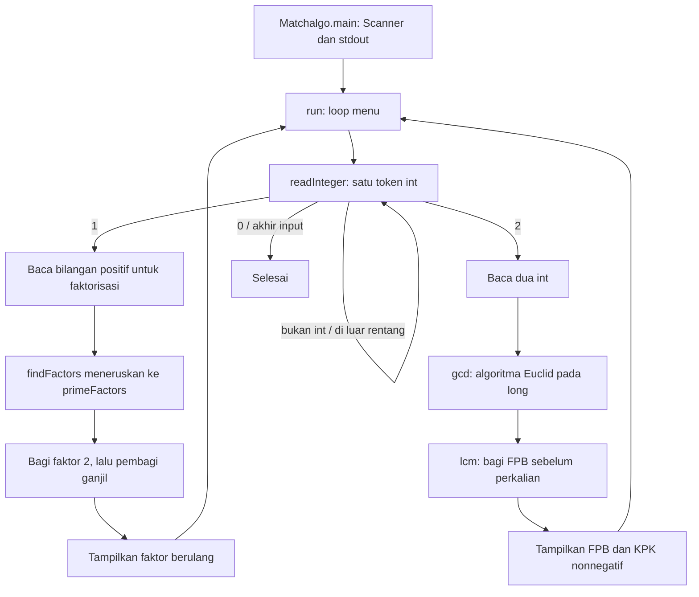

# Alur kode Factorization Math

Program menerima bilangan bulat lewat terminal dan menyediakan faktorisasi prima serta FPB/KPK. Tidak ada database, layanan jaringan atau berkas hasil otomatis.

| Bagian | Sumber |
| --- | --- |
| Menu, input dan adapter API lama | [Matchalgo.java](../src/matchalgo/Matchalgo.java) |
| Perhitungan bilangan bulat | [NumberTheory.java](../src/matchalgo/NumberTheory.java) |
| Tes perhitungan | [NumberTheoryTest.java](../test/matchalgo/NumberTheoryTest.java) |
| Tes input dan menu | [MatchalgoTest.java](../test/matchalgo/MatchalgoTest.java) |

`run()` tidak menutup stream milik pemanggil. `readInteger()` mengambil token dengan `Scanner.next()` lalu `Integer.parseInt()`. Token yang salah dikonsumsi, pesan ditampilkan, dan prompt yang sama diulang. Akhir input mengembalikan `null`; program berhenti tanpa menghitung pasangan yang belum lengkap. Pilihan menu yang tidak dikenal kembali ke menu.

Pada faktorisasi, input negatif ditolak oleh alur konsol. Nol kembali ke menu dan satu memiliki pesan khusus tanpa faktor prima. `primeFactors()` sebagai API mengembalikan daftar kosong untuk input di bawah dua. Untuk nilai lain, fungsi membagi faktor dua berulang kali, lalu pembagi ganjil sampai `divisor <= remaining / divisor`. Bentuk pembagian ini menghindari overflow dari kuadrat pembagi. Sisa di atas satu menjadi faktor terakhir. Faktor disimpan berurutan dengan pengulangan, bukan daftar semua pembagi.

`gcd()` mengubah kedua input `int` ke `long` sebelum nilai absolut diambil. Ini juga menangani `Integer.MIN_VALUE`. Loop Euclid berhenti ketika sisa nol; pasangan nol menghasilkan FPB nol. `lcm()` langsung mengembalikan nol bila salah satu input nol; selain itu, fungsi membagi nilai pertama dengan FPB sebelum mengalikannya dengan nilai kedua. Perhitungan tidak memakai floating point dan hasil nonnegatif dikembalikan sebagai `long`.

Setelah hasil ditampilkan, menu dapat digunakan kembali. Tidak ada penyimpanan sesi atau hasil yang dimuat saat program dibuka ulang. Cara build dan menjalankan tes mandiri ada pada [README](../README.md); perubahan dokumentasi ini tidak mengubah algoritma atau menjalankan ulang tes runtime.
